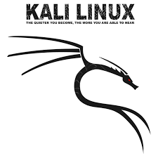

# Kali Linux

### Una plataforma para la seguridad informática

## ¿Qué es Kali Linux?

Kali Linux es una distribución de Linux basada en Debian, diseñada para profesionales y estudiantes de ciberseguridad. Reúne herramientas para pruebas de penetración, análisis forense y auditorías de seguridad, que deben realizarse siempre en sistemas propios o con autorización.

Su historia continúa el legado de las primeras distribuciones especializadas y de [BackTrack Linux](https://www.backtrack-linux.org/). Hoy, Kali es un proyecto de código abierto ampliamente reconocido en el sector.

## ¿Qué la hace especial?

- **Adaptable:** permite crear imágenes ISO y selecciones de herramientas a medida mediante [metapaquetes](https://www.kali.org/docs/general-use/metapackages/) y [compilaciones personalizadas](https://www.kali.org/docs/development/live-build-a-custom-kali-iso/).
- **Portátil:** puede ejecutarse desde un USB Live, con almacenamiento persistente opcional y cifrado.
- **Disponible en muchos entornos:** funciona en equipos de escritorio, máquinas virtuales, la nube, contenedores, WSL y dispositivos ARM.
- **Más allá del ordenador:** ofrece [Kali NetHunter](https://www.kali.org/get-kali/#kali-mobile) para dispositivos Android y [Win-KeX](https://www.kali.org/docs/wsl/win-kex/) para usar un escritorio Kali en WSL.
- **Flexible y recuperable:** incluye opciones como [Kali Undercover](https://www.kali.org/docs/introduction/kali-undercover/) y la posibilidad de crear instantáneas con Btrfs.

En resumen, Kali Linux combina herramientas especializadas y opciones flexibles para ayudar a evaluar y mejorar la seguridad de forma responsable.
